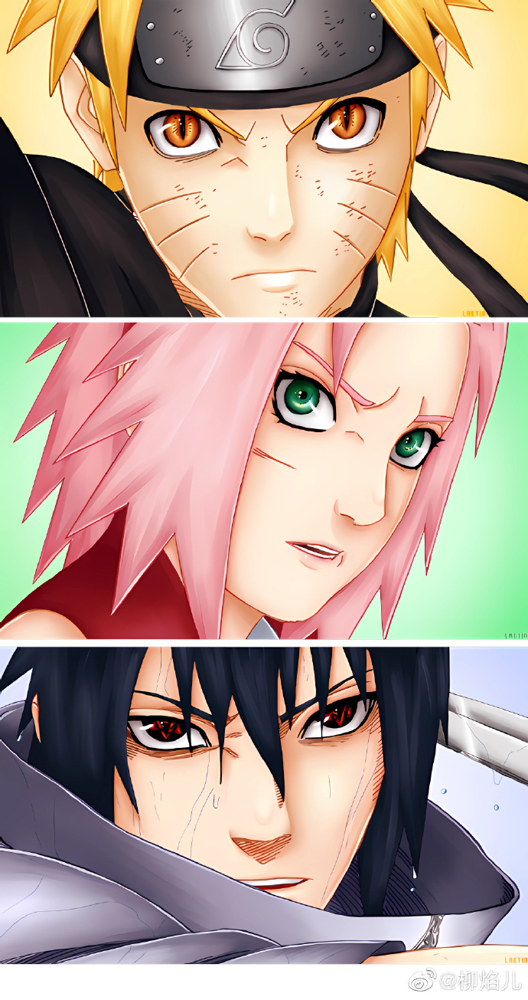
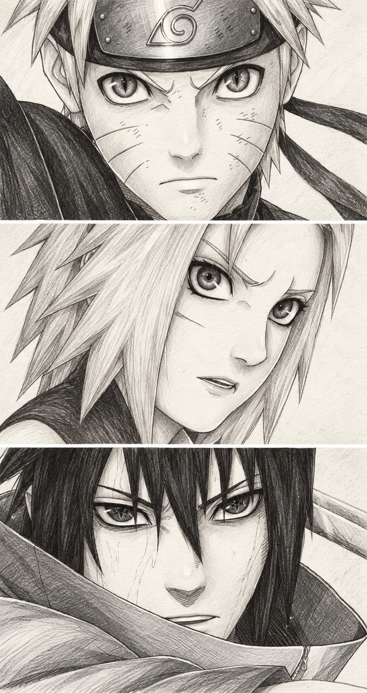

<div align="center">

# ✏️ Pencil Sketch · 日漫素描手稿

**从一张成品图，生成轮廓、中间效果和素描成品三张过程图。**

保留人物和构图，以石墨排线、纸张纹理和手绘明暗，呈现日漫素描从起稿到完成的三个阶段。

</div>

## 效果示例

| 原图 | 手绘成品稿风格示例 |
| :---: | :---: |
|  |  |

以上示例展示最终素描的风格；完整使用本 Skill 时，还会分别生成轮廓稿和中间效果稿。生成结果会随原图、所用图像工具和具体要求变化。示例仅用于展示转换效果，其中人物及原图的相关权利属于各自权利人；展示不代表取得再分发或商业使用授权。使用自己的图片时，请确认拥有相应使用权限。

## 它能做什么

- 根据用户提供的成品图生成至少三张独立图片：手绘轮廓稿、中间效果稿和手绘成品稿。
- 让三张图保持人物、姿态、服饰、视角、画面构图和宽高比一致，清楚呈现由浅入深的完成度。
- 轮廓稿只用少量松散长线勾出头发、头部和衣服的大形，面部细节与阴影都留白；中间稿加入部分排线和阴影；成品稿完成全图石墨明暗与细节。
- 默认使用黑白石墨效果，也可以按要求为指定区域添加淡彩。
- 以附带参考图引导纸纹、线条和明暗；参考图中的人物不是生成主体。

三阶段必须作为独立图片交付；可额外制作拼图预览，但不能以拼图代替。过程图是根据成品图生成的阶段示意，并非真实绘画过程的连续记录。

这个 Skill 提供的是图像处理的工作指引，需要搭配支持图片输入和编辑或生成的 AI 工具使用。若工具一次只能生成一张图，应分阶段逐张生成。它不能保证每次都与原图完全一致；人物细节和画面效果可能需要进一步调整。

## 安装给 Codex

先克隆仓库，然后把完整目录复制到 Codex 的技能目录。Windows PowerShell：

```powershell
git clone https://github.com/GodAI-Master/GodSkill.git
Set-Location .\GodSkill
$skillRoot = Join-Path $env:USERPROFILE ".codex\skills"
$skillPath = Join-Path $skillRoot "artifact-template-pencil-sketch"
if (Test-Path $skillPath) { throw "同名 Skill 已存在，请先检查目标目录。" }
New-Item -ItemType Directory -Path $skillRoot -Force | Out-Null
Copy-Item .\artifact-template-pencil-sketch $skillPath -Recurse
```

macOS / Linux：

```bash
git clone https://github.com/GodAI-Master/GodSkill.git
cd GodSkill
mkdir -p "$HOME/.codex/skills"
[ ! -e "$HOME/.codex/skills/artifact-template-pencil-sketch" ] || { echo "同名 Skill 已存在，请先检查目标目录。"; exit 1; }
cp -R artifact-template-pencil-sketch "$HOME/.codex/skills/"
```

安装前请检查目标目录是否已有同名 Skill，避免覆盖已有内容。若设置了自定义 `CODEX_HOME`，请改为复制到该目录的 `skills/` 下。也可以把完整目录复制到项目的 `.agents/skills/` 下供该项目使用。如果安装后没有出现在列表中，请重新打开 Codex。

## 开始使用

在支持图片编辑或生成的 Codex 环境中上传成品图，然后输入：

> 使用 `$artifact-template-pencil-sketch`，根据这张成品图分别生成三张独立的日漫素描过程图：一张手绘轮廓稿、一张加入部分排线和明暗的中间效果稿，以及一张细节完整的手绘成品稿。保持人物姿态和画面构图一致。

想加入淡彩时，也可以补充：

> 保留黑白素描质感，只给头发添加柔和的彩铅颜色。

Skill 会优先使用你上传的成品图作为内容来源，并用附带图片参考画风。如果所用工具不支持同时接收多张参考图，会在每个阶段优先使用成品图，并通过文字描述画风与阶段完成度。交付时会分别提供三张图片并说明阶段；请按需要检查人物、服饰和构图。

## 文件说明

```text
artifact-template-pencil-sketch/
├── SKILL.md                 # 核心工作指引
├── artifact-template.json   # 模板参考图与预览图配置
├── agents/openai.yaml       # Codex 展示信息
├── assets/
│   ├── reference.png        # 风格参考图
│   └── preview.png          # 模板预览图
├── examples/
│   ├── original.png         # 示例原图
│   └── generated.png        # 示例生成结果
├── _skillhub_meta.json      # 仓库元数据
└── README.md
```

请复制完整目录：[风格参考图](assets/reference.png)、[模板预览图](assets/preview.png)和配置文件是这个模板的一部分。示例图片仅用于说明，不需要作为每次生成的输入。

## 许可与素材

原始 Skill 压缩包未附独立许可文件。仓库的许可说明请参阅[仓库首页](https://github.com/GodAI-Master/GodSkill#readme)，但仓库说明不会自动授予示例图片、角色或其他第三方素材的使用权。公开传播或商业使用素材前，请自行确认相关授权。
