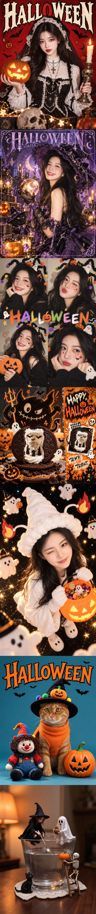

<div align="center">

# 🎃 甜玉米 · 万圣节创意写真

**七种风格，把照片变成你的万圣节主题创作。**

人物、动物或物品都可以选；先挑喜欢的视觉方向，再按对应规范生成写真、海报或创意图片。

</div>

## 选择一种风格

| 编号 | 风格 | 适用主体 | 输出形式 |
| --- | --- | --- | --- |
| 1 | 梦幻紫魔女 · Gothic Lolita | 人物、动物 | 3:4 杂志封面，1 张 |
| 2 | 嗜甜小幽灵 · Sweet Ghost | 人物、动物 | 9:16 系列写真，4 张 |
| 3 | 恶魔影子 × 手绘涂鸦拼贴 | 人物、动物、插画 | 1:1 创意拼贴，1 张 |
| 4 | 暗黑甜酷海报 · Gothic Pop | 人物、动物 | 3:4 海报写真，3 张 |
| 5 | 甜心小丑 · Cutie Clown | 人物、动物 | 3:4 系列写真，3 张 |
| 6 | 微缩奇境 · Tiny Hidden Worlds | 物品 | 3:4 微缩场景，4 张 |
| 7 | 奶萌搞怪 · Sweet Spooky 4-Grid | 人物、动物 | 3:4 四宫格，1 张 |

风格 7 的四宫格是特意设计的单张拼图；其他系列按独立图片交付。不同生成工具对细节和文字的还原能力不同，实际效果会随照片与工具变化。

## 七种风格效果示例

下图汇集了人物、宠物和物品主题的万圣节创作示例；也可[查看原尺寸图片](examples/style-overview.jpg)。

<div align="center">
  <a href="examples/style-overview.jpg"></a>
</div>

## 使用方式

先在 Codex 中安装完整目录，再上传你希望编辑的人物、动物或物品图片。使用示例：

> 使用 `$sweet-corn-halloween`。先给我看 7 种万圣节风格和各自的张数、画幅，我选定后再根据我上传的图片生成。

如果已经选好风格，也可以直接指定：

> 使用 `$sweet-corn-halloween`，选风格 2「嗜甜小幽灵」，根据这张照片生成 4 张独立的竖版写真，保持主体和妆造一致。

没有上传主体图片时，Skill 会先请你提供图片；没有指定风格时，会先展示菜单，等你选择后再生成。

## 安装给 Codex

先克隆仓库，然后复制完整目录。

Windows PowerShell：

```powershell
git clone https://github.com/GodAI-Master/GodSkill.git
Set-Location .\GodSkill
$skillRoot = Join-Path $env:USERPROFILE ".codex\skills"
$skillPath = Join-Path $skillRoot "sweet-corn-halloween"
if (Test-Path $skillPath) { throw "同名 Skill 已存在，请先检查目标目录。" }
New-Item -ItemType Directory -Path $skillRoot -Force | Out-Null
Copy-Item .\sweet-corn-halloween $skillRoot -Recurse
```

macOS / Linux：

```bash
git clone https://github.com/GodAI-Master/GodSkill.git
cd GodSkill
mkdir -p "$HOME/.codex/skills"
[ ! -e "$HOME/.codex/skills/sweet-corn-halloween" ] || { echo "同名 Skill 已存在，请先检查目标目录。"; exit 1; }
cp -R sweet-corn-halloween "$HOME/.codex/skills/"
```

如果设置了自定义 `CODEX_HOME`，请将 Skill 放到该目录的 `skills/` 子目录。也可以把整个 Skill 文件夹放到项目的 `.agents/skills/` 中。安装后若没有出现在列表里，请重新打开 Codex。

## 文件结构

```text
sweet-corn-halloween/
├── SKILL.md
├── README.md
├── _skillhub_meta.json
├── examples/
│   └── style-overview.jpg
├── agents/
│   └── openai.yaml
└── references/
    ├── style-01-gothic-lolita-witch.md
    ├── style-02-sweet-ghost.md
    ├── style-03-devil-shadow-doodle.md
    ├── style-04-gothic-pop.md
    ├── style-05-cutie-clown.md
    ├── style-06-tiny-hidden-worlds.md
    └── style-07-sweet-spooky-4grid.md
```

`SKILL.md` 负责判断何时触发、展示菜单和交付检查；`references/` 保存七种风格的完整绘图提示词。选择风格后才读取对应文件。

## 肖像与素材边界

生成时以用户提供的图片作为主体身份参考，尽量保留人物五官与年龄、动物品种与毛色、物品外观与标识。动物维持真实动物形态，不生成拟人化身体。所选风格的服装、背景和道具可以变化，但不能因此换掉主体。

原始压缩包未附许可证文件。本 Skill 没有另行声明其提示词的许可；仓库层面的许可说明不自动覆盖第三方素材或品牌。使用上传图片前，请确认你有相应使用权限。
